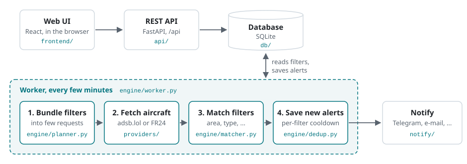

# Contributing

Bug reports and pull requests are welcome. For bigger changes, open an issue first.

## How it works



- `backend/`: Python package `skytripwire` (FastAPI, SQLModel, Alembic). Module paths in the diagram (except
  `frontend/`) are relative to `backend/src/skytripwire/`. The worker runs in the same process as the API.
- `frontend/`: React + TypeScript + Vite. The backend serves the built files.

## Setup

Needs Python 3.13+, Node.js 26+ and pip 25.1+.

```sh
cd backend
python3 -m venv .venv && source .venv/bin/activate
pip install -r requirements.txt
pip install --no-deps -e .
pip install --group dev
skytripwire                        # API on http://127.0.0.1:8000, docs at /docs

cd ../frontend
npm ci
npm run dev                        # UI on http://127.0.0.1:5173, forwards /api to port 8000
```

## Checks (CI runs the same)

```sh
# backend/
ruff check src tests && ruff format --check src tests && mypy && pytest

# frontend/
npm run typecheck && npm run lint && npm run format:check && npm test
npm run e2e                        # Playwright, needs the backend venv
```

After changing the API, run `npm run gen:api` in `frontend/` (venv active) and commit `src/api/schema.ts`.

## Dependencies

- Pin exact versions. Prefer stable releases that are at least two weeks old.
- Python: direct dependencies go into `backend/pyproject.toml`. `backend/requirements.txt` pins all
  packages, including indirect ones (like `package-lock.json`); the Docker image installs from it.
  Update both together.
- Dependabot opens update PRs once a month.

## Conventions

- Everything in English: code, comments, docs, commit messages.
- Keep it simple. No new dependency without a good reason.
