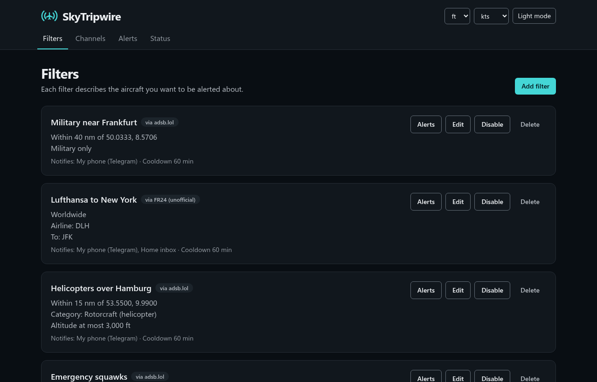
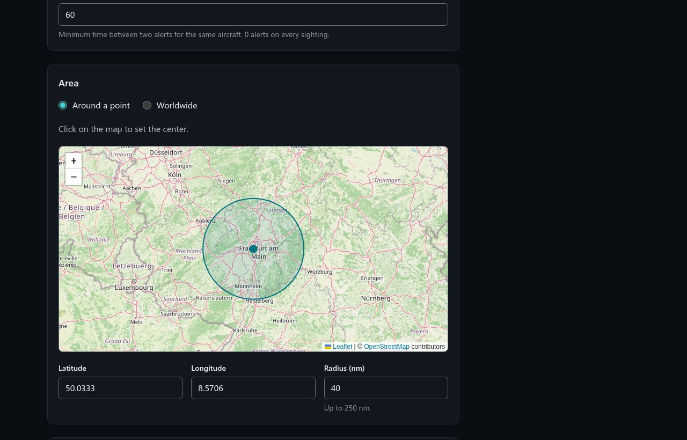

<h1> SkyTripwire</h1>

Get a Telegram or e-mail message when an aircraft you care about shows up.
Self-hosted, small, no account needed.



## Features

- **Filters:** area (point + radius on a map, or worldwide), aircraft type, registration, callsign,
  airline, military, helicopter / glider / balloon / drone, squawk / emergency, altitude, speed
- **Alerts** via Telegram, e-mail or most other [Apprise](https://github.com/caronc/apprise/wiki) services (Discord, Slack, ...)
- **Alert history** with a link to the live track
- **Request budget:** stays within the free limit of the data source on its own
- Units in ft / m and kts / km/h, dark and light mode



## Quick start

Both ways start the web UI on <http://127.0.0.1:8000>.

### With Docker

```sh
git clone https://github.com/vinctdev/SkyTripwire.git && cd SkyTripwire
cp .env.example .env               # optional, all settings have defaults
docker compose up -d               # published image
docker compose up -d --build       # or build the image yourself
```

Data is stored in the Docker volume `skytripwire-data`, created automatically. It survives updates
and `docker compose down`; only `docker compose down -v` deletes it.

### Without Docker

Needs Python 3.13+ and Node.js 26+.

```sh
git clone https://github.com/vinctdev/SkyTripwire.git && cd SkyTripwire
cd frontend && npm ci && npm run build && cd ..
cd backend
python3 -m venv .venv
.venv/bin/pip install -r requirements.txt
.venv/bin/pip install --no-deps .
cp ../.env.example .env            # optional
SKYTRIPWIRE_FRONTEND_DIR=../frontend/dist .venv/bin/skytripwire
```

Data is stored in `backend/data/`. To keep it running in the background, use a service manager
such as systemd.

### Update

- Docker: `git pull && docker compose pull && docker compose up -d` (or `up -d --build`)
- Without Docker: `git pull`, then repeat the build and both `pip install` steps, then restart

## Configuration

Settings are environment variables, usually in `.env`. The most important ones:

| Variable                           | Default | What it does                                           |
| ---------------------------------- | ------- | ------------------------------------------------------ |
| `SKYTRIPWIRE_ADSBLOL_API_KEY`      | none    | Optional. Free adsb.lol key for a higher daily limit   |
| `SKYTRIPWIRE_ADSBLOL_DAILY_BUDGET` | `450`   | Requests per day, keep it a bit below your limit       |
| `SKYTRIPWIRE_FR24_ENABLED`         | `false` | Turn on Flightradar24 as a second source (see below)   |
| `SKYTRIPWIRE_PORT`                 | `8000`  | Port (without Docker; with Docker edit `compose.yaml`) |

All options are listed in [`.env.example`](.env.example).

## Security

- **There is no login.** The app only listens on `127.0.0.1`. For access from other devices, put a
  reverse proxy with authentication or a VPN in front of it.
- Only the host names `127.0.0.1` and `localhost` are accepted, and other websites cannot change
  anything through your browser (protection against DNS rebinding and CSRF).
  Behind a reverse proxy, add your domain: `SKYTRIPWIRE_ALLOWED_HOSTS=sky.example.org`.
- The database contains your channel URLs, **including tokens and passwords**. Keep backups private.
  The app creates its files readable by its own user only.
- Docker: the container runs read-only as UID 10001. If you use a bind mount instead of the volume,
  the directory must belong to UID 10001.

Found a vulnerability? See [SECURITY.md](SECURITY.md).

## Data sources and limits

**adsb.lol (default).** A community network of ADS-B receivers.

- Only aircraft that send ADS-B and are in range of a receiver. Gaps over oceans and remote areas.
- No airport or route data.
- 500 requests per day without a key. SkyTripwire spreads them over the day, so it checks every few
  minutes, not in real time. Filters with the same or overlapping areas share requests.
- Areas up to 250 nm radius.

**Flightradar24 (optional, off by default).** Adds airport and route filters and larger areas.

- SkyTripwire picks the source per filter. adsb.lol is always preferred; FR24 is only used for
  filters adsb.lol cannot handle. Each filter shows its source.
- Uses the **unofficial** [FlightRadarAPI](https://github.com/JeanExtreme002/FlightRadarAPI) library.
  It can stop working at any time.
- For personal and educational use only. For commercial use, contact Flightradar24.

## Disclaimer

SkyTripwire is not affiliated with Flightradar24, adsb.lol or any other flight tracking service.
Alerts can be late or missing; do not rely on them for anything important.
Aircraft data from adsb.lol is licensed under the [ODbL](https://opendatacommons.org/licenses/odbl/).

## Contributing and license

See [CONTRIBUTING.md](CONTRIBUTING.md). Licensed under the [MIT License](LICENSE).
